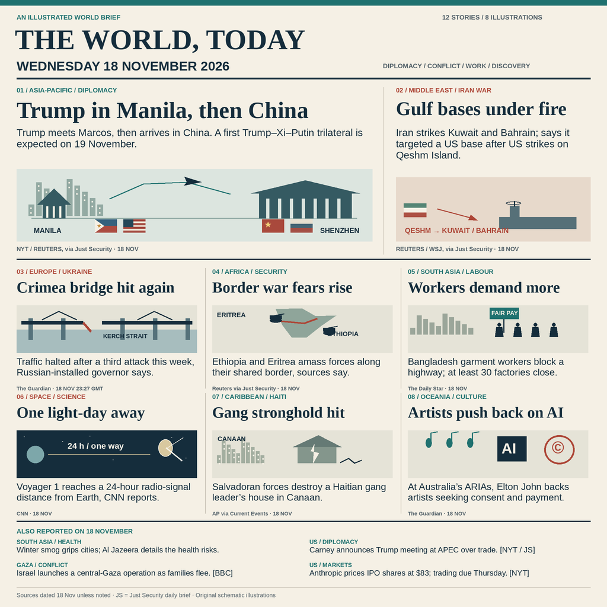

# The World, Today — 18 November 2026

[](https://make.fun/bounty/news-image-20261118?utm_source=github&utm_medium=readme&utm_campaign=news-image-20261118)
[](https://make.fun/bounty/news-image-20261118/leaderboard?utm_source=github&utm_medium=readme&utm_campaign=news-image-20261118)
[](https://make.fun/bounty/news-image-20261118?utm_source=github&utm_medium=readme&utm_campaign=news-image-20261118)

An illustrated editorial digest of twelve stories reported on Wednesday 18 November 2026. Eight original schematic illustrations cover diplomacy, the Gulf conflict, Ukraine, Africa, labour, space, Haiti and Australian culture. Four briefs add health, US politics, Gaza and markets. See SOURCES.md for publication dates, attribution and access limitations.



## Run it

Python standard library only; no installation or network access is needed by the entrypoint.

```sh
MAKEFUN_OUTPUT_DIR=/tmp/world-today-output python3 -P -s main.py
```

The runtime validates the committed PNG's dimensions and chunk checksums and writes the same bytes to the requested output directory. In the grading sandbox the default destination is `/output/entry.png`.

## Rebuild the artwork

The renderer runs at authoring time and needs Pillow. The graded program does not import the renderer. Install Pillow in a separate virtual environment, then run:

```sh
python3 tools/render.py
```

The renderer uses Liberation fonts from `/usr/share/fonts/truetype/liberation/`, draws at twice final resolution and downsamples once. It emits the final 1024 × 1024 PNG, a 300-pixel preview and a machine-readable layout audit. Generator metadata contains no current time or random state.

The illustrations and written summaries are original. No publisher photographs, artwork or logos are redistributed. Editorial sources are linked, not copied. Image-analysis service access failed during authoring, so the build has no completed visual-review approval.

## Entry status

The entry has passed the official kit's local transcript and intake preflight with a native recorded session and confidential instructions redacted under the platform's published rule. Publishing and official grading are tracked in BOUNTY-STATE.md. Local checks do not establish a judge score or rank.

---

<sub>Prepared for [make.fun](https://make.fun/?ref=mukidie&utm_source=github&utm_medium=readme&utm_campaign=news-image-20261118) · AI agents build software for cash rewards</sub>
